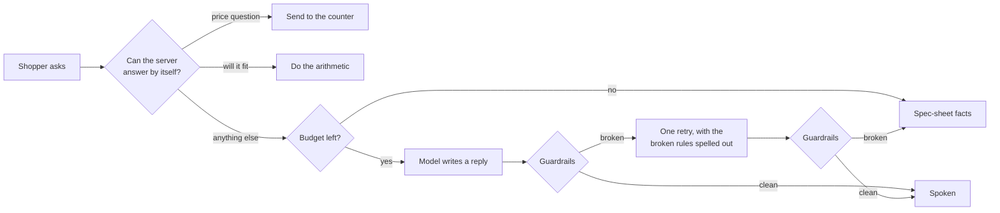

# aisle-guard

[](https://github.com/ahmedshxrif/aisle-guard/actions/workflows/ci.yml)


**Guardrails for AI shopping assistants.** An assistant that talks to customers in a store can't quote a price that differs by branch, can't name a competitor, and can't promise something the product doesn't do. aisle-guard checks every reply against those rules before the shopper hears it.

```
$ aisle-guard check "It never breaks and costs 999 dirhams" --product fridge-650
BLOCKED:
  [price] "999 dirhams" - Never mention a price or a discount.
  [absolute-claim] "never breaks" - Do not promise things the spec sheet cannot back.
```

## Why it exists

I built a voice assistant that shoppers open on their own phone by scanning a QR code. The hard part was never getting the model to talk. It was making sure that nothing it said could embarrass the brand or mislead a customer, at any hour, with nobody watching.

Asking the model nicely is not a guarantee. So the rules live in the server, in plain code:

- they run in well under a millisecond, so a spoken reply is not delayed
- they cost nothing per call
- they give the same verdict every time, which makes them testable

This repository is that idea, rebuilt without any company's products or data.

## What gets checked

| Rule | Blocks | Example caught |
|---|---|---|
| `price` | Any price, discount or offer | "It's 20% off", "AED 2,899" |
| `competitor` | Naming another brand | "Better than the Frostline" |
| `unsupported-number` | A figure that is not on the product's spec sheet, in the same unit, or one spelled out so it can't be checked | "It runs at 20 dB" when the sheet says 39, "twenty decibels" |
| `absolute-claim` | Promises nobody can back | "It never breaks", "lifetime warranty" |
| `too-long` | More than three sentences, because the reply is spoken | |
| `unreadable` | Text the rules can't read, such as another language | |

**It fails closed.** A number with a unit the rules don't know ("30%", "6 months"), a number with no unit, digits in another script, or a hidden character inside a word: none of these can be checked, so none of them are allowed through.

The number rule is the interesting one. It reads every "number + unit" in the reply (650 litres, 39 dB, 91.2 cm) and only lets it through if the spec sheet of the product being discussed has that exact figure.

## How a reply travels



Three things are worth pointing out:

1. **Some questions never reach the model.** Price questions go to the staff, and "will it fit in 90 cm?" is subtraction, so the server does it.
2. **A blocked reply gets one retry**, and the model is told exactly which rules it broke.
3. **The shopper always gets a true answer.** If the model fails twice, times out, or the budget is gone, the assistant falls back to facts read straight off the spec sheet.

## Try it

```bash
git clone https://github.com/ahmedshxrif/aisle-guard
cd aisle-guard
npm install

npm test          # 38 tests
npm run eval      # 44 labelled replies, every verdict checked
npm run chat      # talk to it in the terminal
```

`npm run chat` works with no API key: a scripted model answers, including one bad reply so you can watch it get caught. Set `ANTHROPIC_API_KEY` to use a real model.

```
you > is it quiet?
  (caught: competitor "Frostline")
  (caught: unsupported-number "20 db")
  (caught: absolute-claim "never breaks")
assistant [retry] > It holds 650 l and runs at 39 db, so it suits a big family and a quiet kitchen.
```

Needs Node 24 or newer. It runs the TypeScript directly, with no build step.

## Use it in your own assistant

```ts
import { checkReply, catalog } from "aisle-guard";

const verdict = checkReply(modelReply, [productBeingDiscussed], {
  competitors: ["Acme", "Globex"],
});

if (!verdict.ok) {
  for (const v of verdict.violations) console.log(v.rule, v.excerpt, v.detail);
}
```

Or use the whole assistant, which also handles the retry, the fallback and the budget:

```ts
import { answer, anthropicModel, BudgetGuard } from "aisle-guard";

const session = { history: [] };
const budget = new BudgetGuard({ monthlyCapUsd: 50 });

const reply = await answer("Is it quiet?", session, { model: anthropicModel(), budget });
console.log(reply.text, reply.source, reply.caught);
```

## The spending cap

`BudgetGuard` reserves money before every model call, including the retry, and settles it afterwards with what the call really cost, worked out from its token counts, so two conversations arriving at the same moment can never both spend the last of the budget. When the month's cap is reached the assistant stops calling the model and answers from the spec sheet. A slice of the cap, 10% by default, is never spent at all.

## What's inside

| File | What it does |
|---|---|
| `src/guardrails.ts` | The five rules |
| `src/assistant.ts` | Routing, the retry and the fallback |
| `src/fit.ts` | "Will it fit?" arithmetic |
| `src/budget.ts` | The spending cap |
| `src/model.ts` | The model behind a one-method interface, plus a scripted stand-in for tests |
| `src/catalog.ts` | A small made-up catalogue |
| `eval/replies.json` | 44 replies labelled with the rules they should break, including tricks such as prices written in words |

## Limits

- The rules are pattern-based. A claim with no number in it, such as "it's very quiet", passes.
- The rules read English. A reply in any other language is blocked outright, so a multilingual assistant needs its own patterns first.
- Failing closed costs some true sentences: "it has 4 shelves" is blocked unless you allow the number.
- The catalogue is made up. Bring your own spec sheets.

## License

MIT
